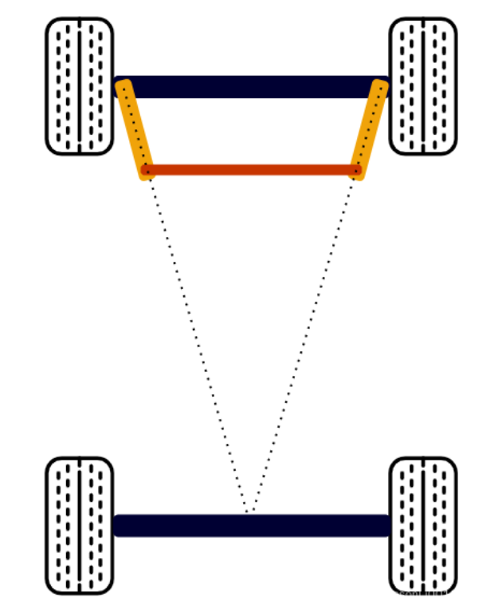
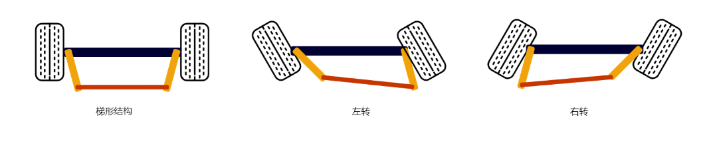

## 阿克曼小车运动学分析

### 阿克曼车型介绍

阿克曼小车结构特点：整车总共 4 个轮子，前面 2 轮为舵机转向轮，后面 2 轮为驱动轮，主要负责整体的移动。与其他各类小车的不同之处在于拥有自己独特的舵机转向，而其他各类小车都是通过左右轮的差速来调节转弯。阿克曼车型主要参数包括左右轴距、前后轮间距以及转弯半径。

传统汽车使用机械差速器完成差速，机械差速器的基本运动规律是：无论转弯或者直行，两侧驱动车轮的转速之和始终等于差速器壳转速的2倍。例如差速器壳转速为V，则内侧后轮的转速为V-a，外侧后轮的转速为V+a。

最近几年电动汽车企业迅速崛起，在电动汽车中，由于使用两个电机直接驱动后轮，不需要机械差速，使得机械设计更加简单。这样在电控方面就更加复杂一点。底盘的前两轮通过一个连杆连接，用于控制车轮运行的方向。通常采用舵机驱动前两轮来控制机器人的方向。

 

### 阿克曼结构动力学模型

阿克曼车型转向特点：

- 之前行驶时，4个车轮的轴线互相平行且垂直与车体纵向中心面；
- 在转向的过程中，4个轮子都必须绕着**一个瞬时中心点做圆周运动**。

阿克曼车型在转弯的时候，内外轮转过的角度不一样，内测轮胎转弯半径小于外侧轮胎，如下图所示，

其中，β是小车前外轮转角、α是小车前内轮转角、K为轮距、L为轴距、R为最小转弯半径，最小转弯半径是阿克曼运动模型中一个非常重要的参数。由此可以得出阿克曼核心公式：

cotβ−cotα=K/L

最小转弯半径R：

低速环境下，

车辆行驶路径的转弯半径变化缓慢，此时我们可以假设车辆的方向变化率等于车辆的角速度。则车辆的角速度为

（）ω=V/R（1.1）

利用轴距L与前轮转角θ关系可得到，

（）1/R=θ/L（1.2）

当滑移角（车子行进方向和轮圈所指的方向两者间所成的这个角度）为很小且后轮偏角为0时，结合1.1和1.2可得出，

ω/V≈1/R=θ/L

上面提到过内外轮胎的转向半径不同，

（）β=L/（R+K/2）

（）α=L/（R−K/2）

则可求出，前轮转角θ为，

（）θ=（β+α）/2≈L/R

所以，最小转弯半径R是，

R=L/θ

根据最小转弯半径预测出车辆的位置：

假设在车辆坐标系下，车辆速度为v，在t时间内移动的距离为v*t，且直达转弯半径为R的情况下，可以推算出车辆转过的角度为σ，

σ=v∗t/R

结合上边计算出来的转弯半径R，可得出，

σ=v∗t/θ/L

则在车辆坐标系下，t时刻后车辆位置坐标更新为，

x(t+1)=R∗(1−cos(σ))

y(t+1)=R∗sin(σ)

 