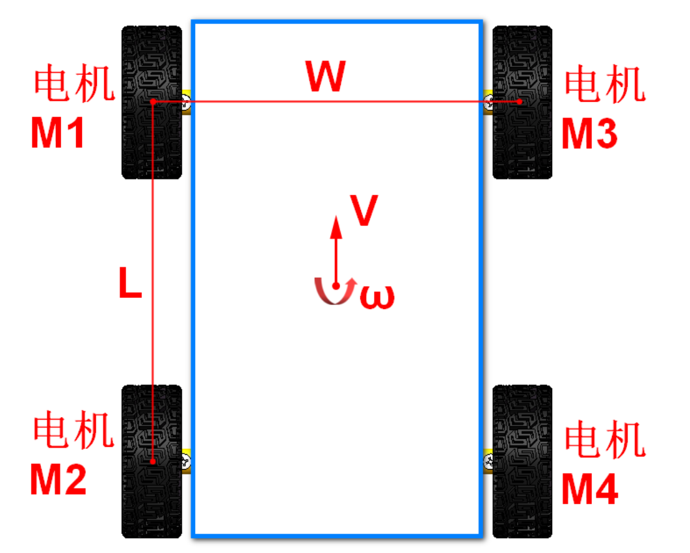

## 四驱小车运动学分析

### 局限性

本节将从四驱车运动学方面分析四轮车的运动学方程，由于真实车子存在结构误差，在运动过程中会阻力和摩擦力等因素，较为复杂，简单起见，这里仅局限于四驱车处于理想状态下做分析。

### 建立运动学模型

将四驱小车抽象为下图模型，其中W表示左右电机中心点的间隔；L表示前后电机中心点的间隔；电机M1、M2、M3、M4表示小车的四个驱动电机；V表示小车的线速度（前进后退速度），ω表示小车角速度（旋转速度）。

理想状态下是通过控制线速度V和角速度ω，转化成控制四个电机，从而控制四驱小车运动。

### 14.3.3、运动学分析

设Vm1，Vm2，Vm3，Vm4为电机M1、M2、M3、M4的速度值，也就是轮子的转速，Vx为小车线速度,Vx为正表示向前，Vx为负表示向后，Vz为小车角速度，Vz为正表示向左，Vz为负表示向右，A为小车左右电机中心点距离W的一半A=W2，B为小车前后电机中心点的距离L的一半B=L2。

当小车前进或者后退时，

Vm1=Vx

Vm2=Vx

Vm3=Vx

Vm4=Vx

小车绕几何中心点自转时，

Vm1=-Vz*(A+B)

Vm2=-Vz*(A+B)

Vm3=Vz*(A+B)

Vm4=Vz*(A+B)

根据以上公式，我们就可以得到

Vm1=Vx-Vz*(A+B)

Vm2=Vx-Vz*(A+B)

Vm3=Vx+Vz*(A+B)

Vm4=Vx+Vz*(A+B)

 