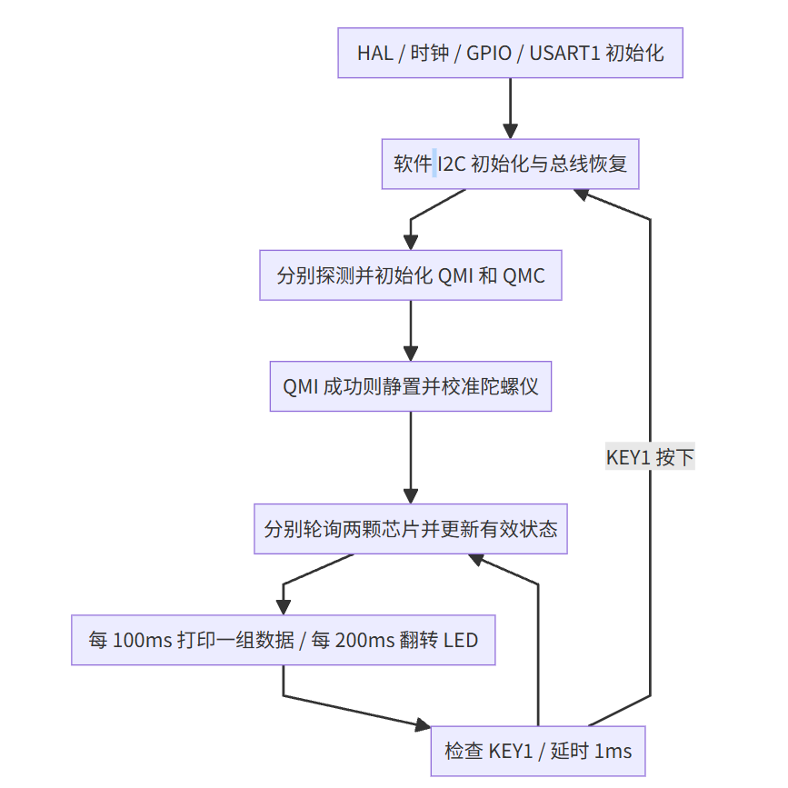

# 六轴 IMU 与磁力计获取数据

> **芯片**：QMI8658B（三轴加速度 + 三轴陀螺仪）、QMC5883P（三轴磁力计）
>
> **平台**：STM32F103RCT6 · HAL 库 · STM32CubeIDE · 软件 I²C（PB13/PB14）· USART1 115200
>
> **配套工程**：`Read_QMI8658B_QMC5883P`

### 实验目的

用软件 I²C 在同一组引脚上访问 QMI8658B 与 QMC5883P：读取原始整型数据、换算为物理量，并在串口助手中以逐行文本的形式观察。两颗芯片的初始化、采集与错误处理相互独立，任一颗异常都不影响另一颗。

### 配置引脚信息

QMI8658B 与 QMC5883P 共用 PB13/PB14 软件 I²C：PB14 作为 SDA，PB13 作为 SCL。

| MCU 引脚    | 设置                          | 用途                           |
| ----------- | ----------------------------- | ------------------------------ |
| PB13        | GPIO_Output，开漏输出，初始高 | 两颗传感器的 SCL               |
| PB14        | GPIO_Output，开漏输出，初始高 | 两颗传感器的 SDA               |
| PA9         | USART1_TX，复用推挽           | 向电脑发送文本                 |
| PA10        | USART1_RX，输入               | 保留串口配置，本案例不解析命令 |
| PC13        | 普通推挽输出                  | 板载 LED，每 200ms 翻转        |
| PC5         | 普通推挽输出                  | 板载蜂鸣器，初始化结束提示     |
| PD2         | 输入上拉，低电平按下          | KEY1，去抖后重新探测并校准     |
| PA13 / PA14 | SWDIO / SWCLK                 | ST-Link 下载调试               |
| PD0 / PD1   | HSE 晶振                      | 8MHz 外部晶振                  |

配置步骤：

1. 直接导入配套工程；打开同名 `.ioc` 可查看引脚与时钟设置。

2. PB13/PB14 设为开漏输出、初始高、无内部上下拉，外部已上拉到 3.3V。

3. SYS 选择 Serial Wire，RCC 选择 HSE Crystal/Ceramic Resonator；系统时钟 72MHz、APB1 36MHz、APB2 72MHz。

4. USART1 选择 Asynchronous：115200、8 位数据、1 位停止位、无校验、无流控。

### 实验流程图解析



串口至少每隔 100ms 打印一次“最近一次成功样本”，因此**采集频率、芯片输出数据率、串口打印频率是三件事**。两颗芯片的样本没有硬件同步，打印内容里的 `age` 分别给出各自数据的新鲜度。

### 核心代码解释

| 文件             | 职责                                                    |
| ---------------- | ------------------------------------------------------- |
| `bsp_imu_i2c.c`  | 软件 I²C：GPIO 模拟时序、DWT 微秒延时、总线恢复         |
| `bsp_qmi8658b.c` | QMI8658B 探测与初始化、同步读帧、单位换算、陀螺零偏校准 |
| `bsp_qmc5883p.c` | QMC5883P 探测与初始化、独立读取、溢出/饱和判定          |
| `bsp.c`          | 初始化调度、主循环、数据打印、LED 与 KEY1               |
| `imu_types.h`    | `ImuResult` 返回码、小端 16 位拼装 `IMU_LE16()`         |

#### 软件 I²C（`bsp_imu_i2c.c`）

- **引脚与时序**：PB13/PB14 配成开漏输出，用 `GPIOB->BSRR` 拉高/拉低，用 `GPIOB->IDR` 回读 SDA；每个电平翻转后插入约 5μs 等待。
- **微秒延时**：直接用 Cortex-M3 的 DWT 周期计数器（`0xE0001004`），按 `SystemCoreClock` 换算周期数，不占用定时器。
- **不阻塞**：每次拉高 SCL 都等待其真正变高，超过约 1ms 判定失败并返回 `false`，从机拉死总线时程序不会卡住。
- **总线恢复**：MCU 复位不会复位传感器，所以 `IMU_I2C_Init()` 最后先做一次恢复——释放 SDA、最多补 9 个 SCL 脉冲让从机吐完半帧、再发 STOP。
- **地址约定**：接口只接收 7 位地址，内部自动拼成 `addr<<1`（写）或 `(addr<<1)|1`（读）；因此要传 `0x6B`，而不是 `0xD6`。

```
ok = i2c_start() && i2c_byte((uint8_t)(addr << 1)) && i2c_byte(reg);
if (ok) ok = i2c_start() && i2c_byte((uint8_t)((addr << 1) | 1u)); /* 重复起始 */
for (i = 0; ok && i < length; ++i) ok = i2c_receive(i + 1u < length, &bytes[i]);
i2c_stop();
```

#### QMI8658B 初始化（`bsp_qmi8658b.c`）

先探测 `0x6B`，失败再探测 `0x6A`，只有 `WHO_AM_I(0x00)` 等于 `0x05` 才确认芯片。

| 顺序 | 寄存器                        |    写入     | 作用                         |
| :--: | ----------------------------- | :---------: | ---------------------------- |
|  1   | CTRL7（0x08）                 |    0x00     | 先关闭加速度计与陀螺仪       |
|  2   | CTRL1（0x02）                 |    0x40     | 多字节访问自动递增           |
|  3   | CTRL2（0x03）                 |    0x06     | 加速度 ±2g、125Hz            |
|  4   | CTRL3（0x04）                 |    0x66     | 角速度 ±1024dps、125Hz       |
|  5   | CTRL5（0x06）                 |    0x77     | 两路 LPF 模式 3，读回校验    |
|  6   | CTRL8（0x09）/ CAL1_L（0x0B） | 0xC0 / 0x01 | 关闭 AHB gating 的命令参数   |
|  7   | CTRL9（0x0A）                 | 0x12 → 0x00 | 触发命令并完成两段握手       |
|  8   | CTRL7（0x08）                 |    0x83     | 开启同步采样与六轴，读回校验 |

- **CTRL9 握手**：写 `0x12` 后轮询 STATUSINT（0x2D）bit7 置位；再写 `0x00` 等 bit7 清零。每段最多轮询 20 次（间隔 1ms），整段最多重试 3 次；握手不成功就不进入同步读取。
- **LPF 校验**：模式 3 的名义截止频率为 125Hz 的 13.37%，约 16.7Hz；读回值与 `0x77` 不符即返回 `IMU_CONFIG_ERROR`，便于实验阶段尽早发现问题。
- 全部配置成功后再等待 100ms 才置 `ready`。

#### 同步读帧与单位换算

`read_frame()` 的流程：读 STATUSINT（0x2D）→ bit0 为 1 表示有新样本 → 等 12μs 后确认 bit1（数据已锁存，最多查 3 次）→ 从 `TEMP_L(0x33)` 连读 14 字节到 `GZ_H(0x40)`。

```
if (!(status & 1u)) {                        /* bit0 = 0：没有新样本 */
    if (status & 2u) { release_sample(); return IMU_IO_ERROR; }
    return IMU_NO_DATA;
}
IMU_DelayUs(12);
for (poll = 0; !(status & 2u) && poll < 3; ++poll)
    IMU_I2C_Read(address, 0x2Du, &status, 1); /* bit1 = 1：数据已锁存 */
if (!(status & 2u) || !IMU_I2C_Read(address, 0x33u, bytes, 14)) goto failed;
```

- **必须读完 14 字节**：只读加速度 6 字节不会释放锁存样本，后续读数会一直出错。
- **失败处理**：任何一步失败都调用 `release_sample()` 读一次 `0x40` 解锁，必要时先恢复总线；返回错误且**不覆盖调用方上一组有效数据**。

| 数据   | 换算（当前量程）   | 本案例输出                    |
| ------ | ------------------ | ----------------------------- |
| 加速度 | `raw / 16384`      | g，乘 9.80665 得 m/s²         |
| 角速度 | `raw / 32`         | dps（°/s），乘 π/180 得 rad/s |
| 温度   | `raw / 256`        | °C，芯片内部温度              |
| 磁场   | `raw × 100 / 3750` | μT（1G = 100μT）              |

- **轴向映射**：物理量统一转到机体坐标 `body = (chipX, -chipY, -chipZ)`；结构体里的 `accel_raw[]`、`gyro_raw[]`、`raw[]` 保留芯片原始轴向，方便对照数据手册。
- **加速度未做零偏扣除**：静止时模长应接近 1g；若芯片 Z 轴为 +1g，本例输出 Z 约为 -1g，翻面后符号改变，不能只凭某一个轴判断好坏。
- **陀螺仪**会扣掉通过静止检查的 RAM 零偏（原始计数不变）；**磁场**没有硬铁/软铁/磁偏角修正，不能直接当航向使用。

#### QMC5883P 初始化与读取（`bsp_qmc5883p.c`）

先探测 `0x2C`，再按总固件的兼容做法探测 `0x0D`，只有寄存器 `0x00` 为 `0x80` 才识别为 QMC5883P——`0x0D` 上应答的其他型号不能凭 ACK 就认定可用。

| 步骤 | 寄存器与值            | 说明                                   |
| :--: | --------------------- | -------------------------------------- |
|  1   | `0x0D = 0x40`         | 沿用总固件 / QST 初始化序列，等待 10ms |
|  2   | `0x29 = 0x06`         | 厂商初始化配置，等待 10ms              |
|  3   | CTRL2（0x0B）= `0x08` | ±8G，对应 3750 LSB/G                   |
|  4   | CTRL1（0x0A）= `0xC9` | 正常测量模式，100Hz                    |
|  5   | 读回 0x0B、0x0A       | 校验一致后等待 20ms 再开始采集         |

```
if (!IMU_I2C_Read(address, 0x09u, &status, 1)) return IMU_IO_ERROR;
if (!(status & 1u)) return IMU_NO_DATA;      /* bit0：磁场数据就绪 */
if (!IMU_I2C_Read(address, 0x01u, bytes, 6)) return IMU_IO_ERROR;
```

- 磁场 XYZ 从 `0x01` 连读 6 字节，低字节在前。
- 状态位 bit1（溢出）或任一轴 `|raw| ≥ 32760`（接近 int16 满量程）判为无效，不替换上一组正常样本。
- 磁场在 `Bsp_Loop()` 中**独立调用**，不受“QMI 是否有新样本”影响，六轴缺失时仍可单独观察磁力计。
- 本目录 QST 参考代码对部分模式的注释较旧，案例以总固件实际使用的 `0xC9` 为准，未改用 `0xCB`。

#### 主循环、零偏校准与数据有效性（`bsp.c`）

`main()` 完成外设初始化后调用 `Bsp_Init()`（传感器初始化 + 蜂鸣器 50ms），随后循环调用 `Bsp_Loop()`：

```
if (imu_ready) imu_result = QMI8658B_Read(&imu);
if (mag_ready) mag_result = QMC5883P_Read(&mag);
/* 每 ≥100ms 打印一次最近样本；每 ≥200ms 翻转 LED；KEY1 去抖 20ms */
HAL_Delay(1);
```

**陀螺仪零偏校准**（最多等 8s，每 10ms 取一个新样本，满 300 个后判定）：

- 各轴均值 `|mean| ≤ 10 dps`；
- 角速度标准差 `≤ 0.15 dps`，加速度标准差 `≤ 0.01 g`；
- 前后半窗（各 150 样本）均值差 `2×|mean − half| ≤ 0.05 dps`；
- 加速度均值模长在 `0.8g ~ 1.2g` 之间。

全部通过才采纳新零偏，否则清零重新计数；超时返回 `IMU_TIMEOUT`，零偏保持 0，按 KEY1 或复位可重做。六轴无法区分“恒定慢速旋转”和“零偏”，所以校准时板子必须静止；本例不做运行中零偏跟踪、不写 Flash、不做加速度六面校准。

**数据打印**：每 100ms 用逐行 `printf` 输出一组，比一长串逗号分隔的字段更容易在串口助手里读：

```
printf("\r\n[%lu ms]\r\n", (unsigned long)now);
printf("  ACC  x=%+.3f  y=%+.3f  z=%+.3f  g\r\n",
       imu.accel_g[0], imu.accel_g[1], imu.accel_g[2]);
printf("  GYRO x=%+.2f  y=%+.2f  z=%+.2f  dps\r\n",
       imu.gyro_dps[0], imu.gyro_dps[1], imu.gyro_dps[2]);
printf("  MAG  x=%+.1f  y=%+.1f  z=%+.1f  uT   TEMP %+.2f C\r\n",
       mag.mag_ut[0], mag.mag_ut[1], mag.mag_ut[2], imu.temperature_c);
printf("  IMU  valid=%u age=%lu ms result=%u errors=%lu\r\n",
       (unsigned)iv, (unsigned long)ia, (unsigned)imu_result, (unsigned long)imu_errors);
printf("  MAG  valid=%u age=%lu ms result=%u errors=%lu\r\n",
       (unsigned)mv, (unsigned long)ma, (unsigned)mag_result, (unsigned long)mag_errors);
```

- `iv` / `mv`、`ia` / `ma` 在打印前算好：`valid=1` 表示有过成功样本、年龄 ≤ 150ms 且当前无读取错误；`age=4294967295` 表示从未成功采样。
- `result` 为最近一次轮询结果：0=OK、1=NO_DATA（无新数据，正常状态）、2=IO_ERROR、3=NOT_FOUND、4=CONFIG_ERROR、5=TIMEOUT、6=OVERFLOW；`errors` 只累计错误，`NO_DATA` 不计。
- 读取失败时结构体保留旧值，所以数值“没有变化”并不代表读取成功，必须结合 `valid` 与 `age` 判断。
- 按 KEY1 重试会清空样本与错误计数，并重新执行启动等待与校准。